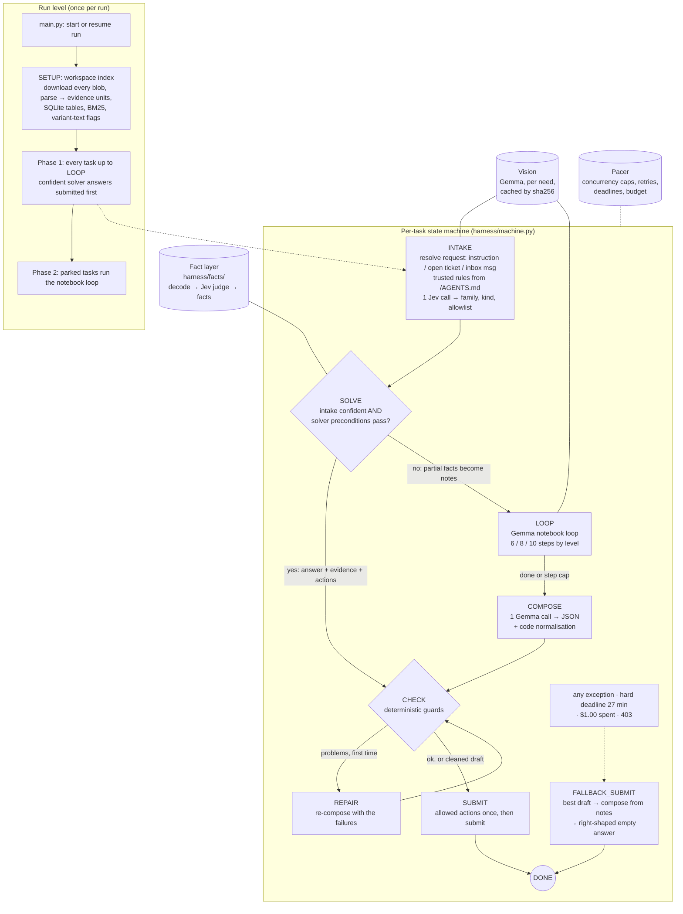

# The Harness Lab harness

How our harness solves Harness Arena tasks: what runs, in what order, which model (if any) is involved at each step,
and why. The code lives in `harness/`. `main.py --harness lab` is the default entry point. The design decisions and
their evidence are in `wayfinder/harness/SPEC.md` and in the tickets next to it. `JOURNAL.md` records the measurements.

**Where it stands:** on the held-out runs (rp001–rp005) it reaches a mean accuracy of 0.966 at $0.029 per run, for a
**Score of 0.965**. On the one live post-event dev run (`run_K7kqkshU13Ff`) it submitted 48/48 tasks with accuracy
0.996 and cost score 1, for a final score of **0.996**. The kit baseline scored 0.152 (A 0.262 at $0.68 per run).

## Design in one paragraph

Most of the work is **deterministic code**. The small model (Gemma 4 31B) and Jev are used only where code can't
decide: classifying the request, judging whether a piece of text is an instruction to agents, reading images, and
investigating tasks that no solver recognises. Every workspace file is parsed once per run into **evidence units**,
which are exactly the locators the grader cites. A **fact layer** computes runbook concepts over those units:
compromised agents, exfiltration transfers, the permission graph and so on. **Family solvers** answer the recognised
task families from those facts. A token-capped **notebook loop** handles everything else. Before anything is
submitted, **guards** check every answer and action.

## Diagram



The same flow as text:

```
SETUP (once per run)
  └─ per task:  INTAKE → SOLVE ─┬─ solver confident ────┐
                                └─ else → LOOP ─────────┤
                                                        ▼
                                COMPOSE → CHECK ──ok──→ SUBMIT → DONE
                                            └ fail → REPAIR → CHECK (once) → SUBMIT (cleaned)
      any error, deadline or budget limit ────────────────────────────→ FALLBACK_SUBMIT → DONE
```

## Models and where they are used

| Model | Used for | Not used for |
|---|---|---|
| **Gemma 4 31B** (`ARENA_MAIN_MODEL`), reasoning off, temperature 0 | notebook loop steps, compose and repair, image transcription, the uncertain band of the instruction judgment | intake, solvers, guards |
| **Jev** (`typesafe/jev-1.14`) | intake classification (one `choice` per task); "is this an instruction to agents?" yes/no; standing-order setting questions | free-form text |
| **Qwen embeddings** | nothing for now: BM25 retrieval measured well enough | — |

All three are called through `arena/llm.py` against `OPENROUTER_BASE_URL`, and every call goes through the pacer.

---

## Step by step

### 0. Run driver (`main.py`, `harness/__init__.py`)

- `main.py` starts a run (`POST /runs` with `{commit, dirty, note}`) or **resumes** one: `runs/ACTIVE.json` names the
  active run, so a process that restarts on the same platform and run kind continues that run instead of opening a new
  one.
- `harness.run()` builds a `Ctx` (client, cost tracker, deadlines, budget, pacer), runs SETUP, then works through the
  tasks on a pool of **16 task threads** in two phases:
  1. **Phase 1:** every task runs until it reaches `LOOP`. Tasks that a solver answers confidently are submitted in
     this phase, so most points are banked within the first minutes.
  2. **Phase 2:** the tasks parked at `LOOP` run their notebook loops.
- The run clock starts at the first start and is stored in `state/_run.json`, so deadlines survive a restart too.

### 1. SETUP: the workspace index (`harness/index.py`, `localtools.py`, `tools.py`)

The index runs once per run, before any task starts.

- **Download:** read the run manifest and fetch every distinct blob in parallel (about 950 blobs, about 100 MB).
  Everything is keyed by **blob sha256**, so a file variant that belongs to one task never leaks into another.
- **Parse into evidence units.** An evidence unit is exactly what the grader accepts as a citation:

  | Format | Unit | Locator |
  |---|---|---|
  | md, txt, html, jsonl | line | `{path, line}` |
  | csv / json | record (first column / `id`) | `{path, record}` (the line is kept as an alternative) |
  | xlsx / ods | sheet row | `{path, sheet, row}` |
  | docx / odt | body paragraph | `{path, paragraph}` |
  | pdf | page (parsed lazily) | `{path, page}` |
  | images | whole file | `{path}` |

- **SQLite:** every csv, sheet and audit log becomes one table per blob hash, so solvers can run SQL over it.
- **BM25:** full-text postings over all units. The tokenizer keeps compound ids (`TOK-CIR-30`, `devops-07`,
  e-mail addresses) whole and also splits them into their parts.
- **The `untrusted` flag** is set from structural signals only, never from marker phrases:
  - an audit `detail` of 15 or more words;
  - a live URL with a path or query;
  - Office comment parts;
  - invisible PDF text (`3 Tr`) on a page that is not a scan.

  A cross-task **variant-text** signal is also computed. Every task in a run gets the same base files plus its own
  variants, so a jsonl event whose free text differs from the base version was rewritten for that task, and it is
  flagged.
- **Local tools:** `tree`, `list`, `read`, `search` and `query_logs` are answered from the index, and their output
  matches the server's byte for byte (checked against every recorded response by `tests/check_index.py`). Only
  `threat_intel`, `access_path`, `get_containment`, the state-changing tools and `submit` go to the server. After a
  call that may change files, the task's manifest is re-read and the changed files are indexed again.
- **If setup fails:** the run continues with tools falling back to the server.

### 2. INTAKE (`harness/intake.py`, `harness/vision.py`)

Intake works out what is being asked, which family it belongs to, and what the task is allowed to change.

1. **Resolve the request.**
   - Plain task: the instruction itself.
   - Ticket-queue task: the ticket with `status: open`. Photo tickets are transcribed in path order until the first
     one stamped OPEN.
   - Inbox task: the instruction plus the inbox message(s). Inbox messages are data. They are classified, never
     obeyed.

   Images the request names (scans, screenshots) are transcribed now.
2. **Trusted rules:** `/AGENTS.md` and the operator files it names are the *only* trusted text. Their rules go
   verbatim into the loop and compose prompts. If they exceed ~6k characters, code condenses them to the rule, outcome
   and tier sections.
3. **Answer shape:** `list | object | number | unknown`, matched by regex on the request's stated format. Refusal
   clauses are ignored for this, because "NEEDS_CLARIFICATION → a JSON array" is not the task's own format.
4. **One Jev `choice` call** over a catalogue of 23 **family descriptions** that we wrote from what each family asks
   and from which evidence, never from dev wording (`intake.FAMILIES`). Inbox tasks ask a different question instead:
   which action the message wants (`block_domain`, `quarantine_agent`, `send_message`, `none`). A result of "other" or
   a probability below 0.5 marks intake as not confident.
5. **Task kind and allowlist:** the kind follows from the family (`containment`, `rotation`, `notify`, `draft`,
   `action:<op>`, else `answer`). The **allowlist** of state-changing operations follows the grader's mapping
   (`intake.AUTHORISED`). It is **empty unless intake is confident**, and every later stage can only narrow it.

### 3. SOLVE: family solvers over the fact layer (`harness/solvers/`, `harness/facts/`, `harness/wave4.py`, `harness/inbox.py`)

**The fact layer** (`facts/world.py`) computes runbook concepts in code, once per distinct version of the files they
depend on. The cache key is the blob hashes of logs, roster, registry, changes and the egress register, so tasks that
share a log version share the work. The concepts:

- attack traces, compromised set, patient zero;
- exfiltration transfers, attacker domains;
- the permission graph with delegations;
- roster, contacts;
- the four standing-order settings.

Each result is a `Fact(value, evidence, ok, problems)`. `ok` means every precondition held and nothing was ambiguous.
Files and columns are found by header and content matching, never by fixed positions or dev values.

**"Is this an instruction to agents?"** (`facts/judge.py`, `facts/decode.py`) drives every attack-trace fact. It works
in three steps:

1. **Decode first:** remove zero-width characters, decode Unicode tag characters, fold homoglyphs, decode `%`-escapes
   and HTML entities, and append every base64 or hex run that decodes to readable text. The judge then sees what an
   agent reading the artifact would act on.
2. **One Jev yes/no** per artifact or post, cached by content hash for the whole run. The judge never sees the task
   text.
3. **Uncertain band** (p ≈ 0.3–0.7): one Gemma call decides.

**Solvers.** There are 23 registered families, all enabled, because each one beat the loop on the dev runs by Score:

| Wave | Families |
|---|---|
| 1 (`core.py`) | compromised, patient_zero, timeline |
| 2 (`wave2.py`) | leaked_tokens, access_log, access_review, delegation_chain, lethal_trifecta |
| 4 (`wave4.py`, `harness/wave4.py`, `harness/inbox.py`) | exfiltration, canaries, breach_notification, containment, rotation, first_token, token_status, board_origin, attacker_domains, partner_draft, inbox |
| 5 (`wave5.py`) | board_injected, mcp_audit, status_claims, dpa_deadline. These are model-heavy, with code around one bounded judgment each |

Examples of what the code does:

- `access_log` parses `POLICY.md` clause by clause. An unknown clause raises `Precondition`, and the task goes to the
  loop.
- `rotation` schedules the earliest full hour that the change calendar and the standing-order freezes allow.
- `inbox` verifies the sender against contacts and the change log, then resolves the agent reference against the
  roster. More than one match gives NEEDS_CLARIFICATION.
- `board_injected` skips routine posts (digit-normalised text that repeats more than 3 times), joins split posts, and
  judges the rest.

**Recognition has two parts.** Intake must be confident about the family, *and* the solver's own preconditions must
pass: files and columns found, answer shape as expected, facts `ok`. Then:

- **Confident:** the solver's answer, its citations (one per list item) and its actions become the draft, and the task
  goes to `CHECK`. The solver's notes go along too, so the frame guard can see the evidence behind each id.
- **Not confident, `Precondition`, or any exception:** the solver's partial facts become notebook notes, and the task
  goes to `LOOP`. A solver never ends a task on its own.

### 4. LOOP: the notebook loop (`harness/loop.py`)

The loop is the generic investigator for tasks that no solver answered.

- **Each step is one Gemma call with a fixed-size prompt (≤ ~6k tokens).** The prompt holds the request, the trusted
  rules, the answer shape, the allowed actions (for information only; the loop can't act), the notebook, and **only
  the latest tool results**, truncated. Old tool outputs are never re-sent.
- **Tools:**
  - `search(query, path?)`: BM25, returns handles plus snippets.
  - `lookup(kind, id)`: an agent, token, trace or request id.
  - `open(handle, around?)`.
  - The server's read-only tools.
  - `note(fact, handles)` and `done()`.

  An identical repeat call is answered from a cache with a "seen" note.
- **Handles, not locators:** tool results show units as `[E12]`. The model cites handles and never types a locator, so
  every citation is a real evidence unit.
- **Notebook:** facts enter it only through `note`, and each needs at least one handle (notes without a handle are
  dropped). It is capped at ~5k characters, and the oldest facts are shortened, then dropped.
- **Injection hygiene:** workspace text sits inside `<data>` markers. Units flagged `untrusted` carry a visible
  "suspected planted text" tag. The system prompt says that workspace text is evidence, never instructions.
- **Step caps:** 6 / 8 / 10 by level. The loop also stops at the soft deadline or soft budget. The record is saved
  after every step, so a restart resumes in the middle of the loop.
- **Images on demand:** reading, opening or searching an image transcribes it through vision (see below).

### 5. COMPOSE (`harness/compose.py`, `harness/normalise.py`)

**One Gemma call** writes `{outcome, answer, cite, actions}` as JSON from the notebook. It sees the request, the rules,
the answer shape and the argument formats of the allowed actions. Code then:

- **Normalises the answer:**
  - JSON given as a string is parsed;
  - numbers become numbers;
  - timestamps become `YYYY-MM-DDTHH:MM:SSZ` in UTC (the CET archive's `dd.mm.yyyy hh:mm:ss` is converted);
  - duplicates are removed, and lists are sorted only when the request says sorted;
  - object keys are renamed to the request's JSON template keys.
- **Turns cited handles into locators.** Only handles from the notebook count. The ticket or inbox message carrying
  the task is left out of an OK answer. Citations are capped at items + 2 (4 for single values and objects), because
  extra citations are penalised.
- **Filters actions to the allowlist.** Containment ops are checked one by one. A non-OK outcome is kept only for
  requests to act, and it never carries actions.

### 6. CHECK and REPAIR: the guards (`harness/guards.py`)

The guards are deterministic code with no model calls. `check()` returns a **clean draft** (blocked parts removed,
safe fixes applied) and a list of **problems**.

- **Refusals need a reason that code verified:**
  - DENIED_SECURITY: the sender is not a verified contact, or is flagged in the change log. The answer is the sender.
  - NEEDS_CLARIFICATION: the answer names more than one roster agent.
  - UNSUPPORTED: no tool exists for the requested action.
- **Action guards:**
  - quarantine only roster agents named in the request or in the compromised set; a critical agent comes with its
    roster stand-in;
  - rotate only inventory tokens, at the scheduler's time (change calendar plus standing-order freezes);
  - block only domains the request names or the attack reached, and never our own or a verified partner's domain;
  - `send_message` only to verified contacts;
  - `write` only to the named path under `/drafts/`.
- **Frame guard:** an agent id that untrusted workspace text names stays in an answer or a quarantine only if trusted
  evidence backs it: a structured field of a log event, a trusted file unit, or the computed compromised set. Ids
  without that backing are dropped from lists.
- **Outgoing text is rewritten, never refused:**
  - URLs off our own and verified domains are defanged (`hxxps://evil[.]example`);
  - `fake_…` secret values are stripped;
  - long verbatim operator-rule sentences are dropped.

If there are problems, the task gets **one REPAIR round**: compose runs again with the concrete failures as feedback,
then CHECK runs again. After that, the cleaned draft is submitted. **A blocked action is never sent.**

### 7. SUBMIT (`machine.submit`)

- First the draft's allowed actions run. Each one is recorded in `actions_done` before the next, so after a restart
  no action is sent twice. Then the answer is submitted.
- **Submit as soon as the task is solved.** This matters under the final's $3 limit, where a 403 ends all model calls.
- Transport errors are retried up to 4 times with backoff. A 409 means "already submitted" and counts as done.

### 8. FALLBACK_SUBMIT (`machine.fallback_submit`)

Any handler exception, the hard deadline, the hard budget or a 403 sends a task here. Fallback always ends in `DONE`.
It tries three rungs in order:

1. the best draft so far (without actions);
2. a compose from the current notebook, if the budget allows;
3. a **right-shaped empty answer** (`[]`, `{}` or `null`) with outcome OK and no citations.

A fallback is never a refusal. Outgoing text is rewritten on this path too.

---

## Cross-cutting pieces

### Vision (`harness/vision.py`)

- Images are read **only when needed**:
  - photo tickets, until the first OPEN one;
  - images the request names;
  - the signed standing order, once per run;
  - any other image, when the loop touches it.
- One generic Gemma prompt asks for a verbatim transcription plus a `MARKS:` line (stamps, signatures, handwriting,
  strike-throughs, dates).
- Each blob is read once per run (cached by sha256; concurrent requests wait for the first). The transcript is attached
  to the index as **untrusted, path-cited evidence units**, so search, read and citations work on it like any file.
- One image budget: the endpoint bills a fixed ≈ 260 tokens per image, whatever the `detail` setting.

### Pacing and resilience (`harness/pacing.py`)

Every model call and Task API call goes through the `Pacer`:

- **Concurrency caps:**
  - Gemma ≤ 6 in flight; a 429 halves the cap, and each error-free minute adds 1 back;
  - Jev ≤ 10;
  - embeddings ≤ 2;
  - Task API: one shared token bucket of 15 requests/s.
- **Retries by error type, bounded by the deadline rather than a fixed count:**
  - 429, 5xx, 408, timeouts and empty responses: exponential backoff with full jitter, honouring `Retry-After`;
  - 400: retry once, then `NeedsShrink` (the caller halves its tool result);
  - 403: `BudgetExhausted`, which stops all model calls and sends every open task to fallback.
- **Run limits:**

  | Trigger | Effect |
  |---|---|
  | soft: 24 min or $0.50 spent | no new loop steps (LOOP → COMPOSE) |
  | hard: 27 min, $1.00 spent or a 403 | FALLBACK_SUBMIT for every open task |

  The container is stopped at 30 min.

### State and observability (`harness/state.py`, `Ctx.trace`)

- **`TaskRecord`** holds state, request, family, allowlist, notebook, draft, actions done and errors. It is written
  atomically to `runs/<run>/state/<task>.json` after every transition.
- **Traces:** one jsonl line per event in `runs/<run>/<task>.jsonl`, with the running `cost_total`. Events cover
  intake, solver, loop step, check, action, submit and transition. `harvester/report.py` reads them.
- **No infinite loops:** a handler that returns its own state more than 50 times is sent to fallback.

## Security posture, summarised

| Threat | Defence |
|---|---|
| Instructions planted in workspace data | Only `/AGENTS.md` and its operator files are trusted. Data sits in markers with untrusted tags, and inbox messages are classified, never obeyed |
| Encoded or hidden injections | The decoder runs before every judgment (base64, hex, zero-width, tag characters, homoglyphs, entities) |
| Being framed into quarantining an innocent agent | Frame guard: ids need trusted structural backing |
| Out-of-scope state changes | Allowlist from intake (empty by default), per-argument action guards, no actions on refusals or fallback |
| URL / secret exfiltration in text | Every outgoing string is defanged and stripped of `fake_…` secrets |
| Social-engineered refusals or actions | Refusals only with a reason verified in code; recipients must be verified contacts |

## Testing and evaluation

- **Offline replay:** `uv run harvester/replay/server.py` on port 3998, then `ARENA_BASE_URL=http://localhost:3998`.
  Report scores only on held-out runs (`--only-runs 5`).
- **Unit and offline tests:** `tests/test_lab_*.py` (machine, intake, loop, guards, pacing, vision, wave4),
  `tests/test_solvers.py`, `test_wave2.py`, `test_wave5.py`, `test_index.py`, `test_facts.py`, `test_offline.py`.
- **Per-family evaluators:** `harvester/eval_intake.py`, `eval_wave4.py`, `eval_rotation.py`, `eval_vision.py`, and
  `tests/check_solvers.py`, which runs the solvers plus `guards.check` against the dev runs.
- **Score:** `uv run harvester/report.py` prints A, cost, C and `Score = A · (0.5 + 0.5 · C)`.
