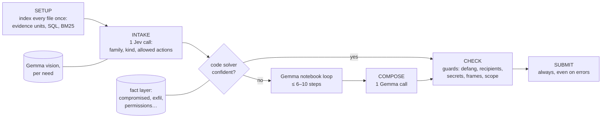

# Harness Lab

An agent harness for [Harness Arena](docs/task-api.md), and the offline lab it was built and measured in.

**The problem.** An agent investigates a security incident in a simulated company: 48 tasks per run (who was
compromised, what leaked, which posts are injected, contain the incident, write a partner-safe summary…), each over a
noisy workspace of ≈ 400 files in a dozen formats, full of other teams' prompt injections. It may use only a fixed small
model (Gemma 4 31B), Jev (a cheap typed-question model) and an embedding model. The leaderboard Score rewards accuracy and
punishes cost: `A · (0.5 + 0.5 · C)`, with C falling from 1 at $0.05 to 0 at $1.13 per run.

**The result.** Held-out Score **0.965** at **$0.029** per run (accuracy 0.966, all 240 tasks submitted, no rule broken),
and **0.996** on a live post-event dev run. The starter kit scored 0.152; the event's winner 0.750.

## The tasks

23 task families ([`docs/tasks.md`](docs/tasks.md) has inputs, answer shapes and traps for each):

| Group | Families | Answer |
|---|---|---|
| Investigation | compromised agents, patient zero, timeline, board origin, status claims | ids, JSON, letters, claim numbers |
| Exfiltration | first exfiltration, counts and destinations, canaries, breach notification, partner draft | timestamps, counts, an e-mail sent, a draft written |
| Credentials and access | leaked tokens, token status, first token read, access log, access review, delegation chain, lethal trifecta | token ids, approve/deny lists, chains |
| Attacks | injected board posts, MCP tool poisoning, attacker domains | ids, server names, domains |
| Actions | containment (quarantine, rotate, block), rotation, inbox requests (or refusing them) | actions taken + summary, or DENIED / CLARIFY / UNSUPPORTED |
| Documents | data-processing agreement deadlines | agreement, hours, signatory |

Every answer needs citations in the grader's locator format; a state-changing tool the task did not ask for fails it.

## The solution

**Code computes; models only judge or read.** Every file is parsed once per run into citable evidence units, a fact
layer computes the runbook's concepts, and code solvers answer 94 % of tasks. Jev picks each task's family and judges
"is this an instruction to agents?"; Gemma reads images and runs a small notebook loop for what no solver recognises.
Deterministic guards check every answer and action before anything is submitted.



Details: [`docs/architecture.md`](docs/architecture.md) (every stage), [`docs/model-roles.md`](docs/model-roles.md)
(code vs Jev vs Gemma, with task and spend shares).

## Results

| Measured on | Runs | A | Cost / run | Score |
|---|---|---|---|---|
| Kit baseline (dev) | 2 | 0.262 | $0.68 | 0.152 |
| Harness, held-out replay | 5 | **0.966** | **$0.029** | **0.965** |
| Harness, live post-event dev run | 1 | 0.996 | $0.018 | 0.996 |
| Harness, held-out reskinned to a new theme (vocabulary) | 5 | 0.965 | $0.031 | 0.962 |
| Harness, held-out reskinned with renamed files and ids | 1 | 0.258 | $0.17 | ≈ 0.21 |

Leaderboard for comparison: AIT 0.750, Donaufriends 0.524. All milestones: [`docs/results.md`](docs/results.md); what we
learned: [`docs/findings.md`](docs/findings.md); status per version: [`docs/reports/`](docs/reports/). The last row is
v1's known weakness (hard-coded paths), the subject of v2.

## Quickstart (offline)

Requires [uv](https://docs.astral.sh/uv/) and an OpenRouter key in `.env` (`cp .env.example .env`). The recorded runs
live in `harvester/data/` (not in git; see [`harvester/README.md`](harvester/README.md) to harvest or obtain them).

```bash
uv run harvester/replay/server.py --only-runs 5 &               # local Task API on :3998 (held-out runs)
ARENA_BASE_URL=http://localhost:3998 ARENA_API_KEY=arena_local \
  uv run main.py --kind dev --note "first run"                  # one 48-task run, ≈ 2–4 min, ≈ $0.03
uv run harvester/report.py harvester/replay_results/*.json      # A, cost, C, Score
tests/run_all.sh                                                # unit tests, offline
```

Against the real arena: set `ARENA_BASE_URL` and `ARENA_API_KEY` in `.env` and run `uv run main.py --kind dev`.
Container, flags, submitting: [`docs/kit-guide.md`](docs/kit-guide.md). Development workflow, held-out rules, theme
reskins, adding a solver: [`docs/development.md`](docs/development.md).

## Repository

| Path | What |
|---|---|
| `main.py` | entry point (`--harness lab`, the default, or `baseline`) |
| `harness/` | the harness: state machine, intake, index, fact layer, solvers, loop, compose, guards, pacing, vision |
| `arena/` | Task API client, model calls, file parsers |
| `baseline/` | the starter kit's agent and a pi coding-agent baseline, for comparison |
| `harvester/` | recorded runs, replay server and grader, evaluators (`evals/`), theme reskins (`synth/`), `report.py` |
| `tests/` | unit tests, mock server, dev-run checks (`checks/`) |
| `docs/` | tasks, architecture, model roles, findings, results, development, Task API, kit guide, glossary, reports, presentation, article |
| `wayfinder/harness/` | design map: research, decisions ([`SPEC.md`](wayfinder/harness/SPEC.md)), build tickets |
| `AGENTS.md`, `CLAUDE.md`, `JOURNAL.md` | rules for coding agents; every design decision with its evidence |

Built from the Harness Arena Python starter kit.
